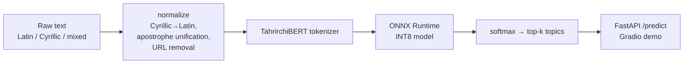

# Mavzu 🇺🇿 — Uzbek News Topic Classification

[](https://github.com/<your-username>/mavzu/actions/workflows/ci.yml)
[](https://huggingface.co/spaces/<your-username>/mavzu)
[](https://huggingface.co/<your-username>/mavzu)


*Mavzu* means "topic" in Uzbek. This project classifies Uzbek news text into **15 topics**
with a fine-tuned Uzbek BERT, serves it as an **INT8 ONNX** model behind a FastAPI service,
and handles both of the scripts Uzbek is written in: **Latin and Cyrillic**.

> **Why it is not just another text classifier.** Uzbek is a low-resource, agglutinative
> language written in two alphabets. The public training corpus and the best Uzbek language
> model are Latin-only, while a large share of real text (Telegram channels, government sites,
> older media) is Cyrillic. A model that scores well on the benchmark can still fail on the
> text people actually send it. This repo measures that gap and closes it.

<!-- TODO: replace with a GIF of the Gradio demo (Latin + Cyrillic example) -->

## Results

Test split of [`murodbek/uz-text-classification`](https://huggingface.co/datasets/murodbek/uz-text-classification)
after removing articles that also appear in the training set (see [Data](#data)).

| Model | Params | Macro-F1 | Accuracy | CPU latency p50 | Size |
|---|---:|---:|---:|---:|---:|
| TF-IDF (word + char) + LinearSVC | — | _TBD_ | _TBD_ | _TBD_ | _TBD_ |
| TahrirchiBERT-small, fine-tuned (PyTorch) | 67M | _TBD_ | _TBD_ | _TBD_ | _TBD_ |
| ↳ ONNX fp32 | 67M | _TBD_ | _TBD_ | _TBD_ | _TBD_ |
| ↳ **ONNX INT8 (served)** | 67M | _TBD_ | _TBD_ | _TBD_ | _TBD_ |

**Script robustness** — the same test articles transliterated to Cyrillic:

| Model | Latin | Cyrillic, raw | Cyrillic, normalized (ours) |
|---|---:|---:|---:|
| Baseline | _TBD_ | _TBD_ | _TBD_ |
| TahrirchiBERT-small | _TBD_ | _TBD_ | _TBD_ |

Numbers come from `reports/*/metrics.json` and `reports/*/robustness.json`, produced by
`make baseline eval`. Confusion matrices: `reports/*/confusion_matrix.png`.

<!-- TODO: embed reports/onnx_model.int8/confusion_matrix.png and 2–3 sentences of error analysis,
e.g. which topics get confused (O‘zbekiston vs Jamiyat?) and why. -->

## How it works



**Text normalization** (`src/mavzu/text.py`)
- Rule-based Uzbek Cyrillic → Latin transliteration that follows the official alphabet rules
  (`е` → `ye` at word start and after vowels, `ц` → `s`/`ts`, `ў` → `o‘`, `ғ` → `g‘`, case-aware
  for `ЧИЛОНЗОР` → `CHILONZOR` vs `Чилонзор` → `Chilonzor`).
- Uzbek Latin uses two different apostrophes (`o‘zbek` vs `ma’lumot`), and people type them as
  `'`, `` ` ``, `ʻ`, `ʼ`, `’`. All variants are collapsed into the two forms the corpus uses, so
  the tokenizer sees one spelling of every word.
- Latin → Cyrillic is also implemented; it generates the synthetic Cyrillic test set.

**Models**
- *Baseline*: TF-IDF over word 1–2-grams **and** character 2–5-grams + calibrated LinearSVC.
  Char n-grams matter for an agglutinative language where one stem appears with dozens of
  suffixes (`maktab`, `maktabda`, `maktablarimizdan`).
- *Transformer*: [`tahrirchi/tahrirchi-bert-small`](https://huggingface.co/tahrirchi/tahrirchi-bert-small),
  an Uzbek BERT, fine-tuned with label smoothing, linear warm-up and early stopping on macro-F1.
  Trained on an Apple Silicon MacBook (MPS backend) using a stratified subsample of the train set.
- *Serving*: exported to ONNX and dynamically quantized to INT8; `export_onnx.py` checks
  prediction agreement with PyTorch before the model is used.

## Data

[`murodbek/uz-text-classification`](https://huggingface.co/datasets/murodbek/uz-text-classification)
— 512,750 Latin-script articles from 9 Uzbek news sites, 15 categories
([Kuriyozov et al., 2023](https://arxiv.org/abs/2302.14494)).

`make data` downloads it, normalizes text, truncates to the first 3,000 characters and runs a
**leakage audit**: the same article is often republished by several outlets, so near-duplicates
(by a normalized text fingerprint) that appear in both train and test are removed from the
evaluation splits. Counts are written to `data/processed/stats.json`.

<!-- TODO: fill from stats.json — "N test articles (X%) were duplicates of training articles" -->

## Quickstart

```bash
git clone https://github.com/<your-username>/mavzu && cd mavzu
conda create -n mavzu python=3.11 -y && conda activate mavzu
make setup

make data       # download + normalize + leakage audit
make baseline   # train and evaluate the TF-IDF baseline
make smoke      # 2k-sample transformer run to check the pipeline
make train      # full fine-tune (MPS / CUDA / CPU, picked automatically)
make resume     # continue an interrupted `make train` from its last checkpoint
make export     # ONNX fp32 + INT8, parity check vs PyTorch
make eval       # reports/ for the PyTorch and ONNX models
make serve      # http://localhost:8000/docs
make demo       # Gradio UI
```

### API

```bash
curl -s localhost:8000/predict -H 'content-type: application/json' \
  -d '{"text": "Ўзбекистон терма жамоаси ғалаба қозонди", "top_k": 3}'
```

```jsonc
{
  "label": "Sport", "label_en": "Sport", "score": 0.97, "script": "cyrillic",
  "top_k": [{"label": "Sport", "label_en": "Sport", "score": 0.97}, ...]
}
```

Also: `POST /predict/batch` (up to 64 texts), `GET /labels`, `GET /health`.

### Docker

```bash
make export
docker build -t mavzu . && docker run -p 8000:8000 mavzu
```

The image contains only ONNX Runtime and the tokenizer — no PyTorch.

## Project structure

```
src/mavzu/
  text.py               normalization, Cyrillic↔Latin transliteration, script detection
  data.py               download, normalize, stratified sampling, leakage audit
  baseline.py           TF-IDF + LinearSVC
  train_transformer.py  TahrirchiBERT fine-tuning (HF Trainer, MPS-aware)
  export_onnx.py        ONNX export + INT8 quantization + parity check
  evaluate.py           metrics, confusion matrix, Cyrillic robustness, latency, error dump
  predict.py            one Predictor interface for sklearn / PyTorch / ONNX
  api.py                FastAPI service
app.py                  Gradio demo (Hugging Face Space)
configs/                training configs
tests/                  unit + API tests on a synthetic dataset (no downloads, runs in seconds)
```

## Limitations

- Trained on news; short informal text (Telegram comments, mixed Uzbek-Russian) is out of domain.
- The Cyrillic evaluation set is produced by rule-based transliteration, so it is cleaner than
  real Cyrillic text.
- Some categories overlap by design (*O‘zbekiston* / *Jamiyat* / *Siyosat*); the labels reflect
  the section an outlet chose, not a strict taxonomy.

## Acknowledgements

- Dataset: E. Kuriyozov, U. Salaev et al., *Text classification dataset and analysis for Uzbek language*, 2023.
- Model: [TahrirchiBERT](https://huggingface.co/tahrirchi) by Tahrirchi.

## License

MIT for the code. The dataset and the base model have their own licenses; check them before
commercial use.
